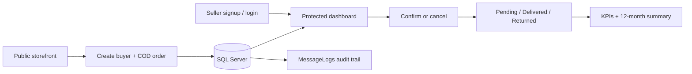

<div align="center">


**A Flask and SQL Server application for seller onboarding, storefront orders, verification, delivery tracking, and reporting.**


</div>

## Overview

DukaanDesk is a server-rendered web application for managing cash-on-delivery orders across seller-specific storefronts. Sellers can create accounts, receive orders through a public domain-based form, confirm or cancel incoming orders, update delivery outcomes, search operational records, and review twelve-month summaries and revenue indicators.

The backend is implemented with Flask and `pyodbc`; Microsoft SQL Server stores sellers, portal users, buyers, orders, and message logs. A small fallback dataset and demo account allow parts of the interface to remain inspectable when the database is unavailable.

## Key Features

- Seller signup with business, WhatsApp, email, domain, username, and password fields.
- Domain-aware public storefront order submission.
- Seller-scoped buyer and order numbering.
- Reuse of existing buyers by seller and phone number.
- Login attempt tracking with account lockout after three failures.
- Protected seller dashboard and session-based authentication.
- Confirm/cancel actions for pending COD orders.
- Delivery tracking for pending, delivered, and returned orders.
- Search across identifiers, buyer details, address, amounts, dates, and statuses.
- KPI summaries for total, active, confirmed, cancelled/returned, and delivered revenue.
- Twelve-month summaries grouped by delivered, cancelled, and returned outcomes.
- SQL trigger that creates an initial message-log entry for each new order.

## Application Flow



## Database Design

The schema is centered on five tables:

- `Sellers` stores business identity, WhatsApp number, email, and domain.
- `ClientUsers` stores seller-linked login accounts and failed-attempt state.
- `Buyers` stores seller-scoped customer profiles and numbering.
- `Orders` stores seller-scoped order numbers, amount, confirmation state, delivery state, and timestamps.
- `MessageLogs` is a child entity used for order messages and audit history.

Important constraints keep seller domains, emails, usernames, and seller-relative identifiers unique. `trg_AutoLogCreation` inserts an initial queued-confirmation message when an order is created. `vw_PendingConfirmations` exposes pending orders with seller and buyer details.

> Password values are currently compared directly with the `PasswordHash` column. The project is suitable for coursework and local demonstration, but password hashing and production security hardening would be required before real deployment.

## Project Structure

```text
DukaanDesk/
├── app.py                 # Flask routes, sessions, database access, and business logic
├── public/
│   ├── login.html         # Seller login
│   ├── signup.html        # Seller onboarding
│   ├── dashboard.html     # Active order operations and KPIs
│   ├── summary.html       # Twelve-month outcome summaries
│   ├── store.html         # Public domain-based order form
│   └── styles.css         # Shared interface styling
├── 1_Schema.sql           # Database and table creation
├── 2_Logic.sql            # Pending-order view and insert trigger
├── 3_DataTesting.sql      # Local sample data
├── 4_Reports.sql          # Seller performance and audit queries
├── reset.sql              # Database reset helper
├── requirements.txt       # Flask and pyodbc
└── package.json           # Legacy Node dependency manifest
```

The running application is Python/Flask-based. The Node dependencies in `package.json` are not used by `app.py` and are not required for the documented setup.

## Installation

### Prerequisites

- Python 3.10 or newer
- Microsoft SQL Server or SQL Server Express
- SQL Server Management Studio or another T-SQL client
- Microsoft ODBC Driver 18 for SQL Server

### 1. Install the Application

```powershell
git clone https://github.com/FarisDosani/DukaanDesk.git
cd DukaanDesk

python -m venv venv
.\venv\Scripts\Activate.ps1
pip install -r requirements.txt
```

### 2. Create the Database

Run the SQL scripts against your local SQL Server in this order:

1. `1_Schema.sql` — recreates `CODManager` and its tables.
2. `2_Logic.sql` — creates the pending-order view and order-log trigger.
3. `3_DataTesting.sql` — optional sample data for local testing.

`1_Schema.sql` drops an existing `CODManager` database before rebuilding it. Review the target server carefully before executing it.

`4_Reports.sql` contains read-only example reports and can be run after data exists.

### 3. Configure the Connection

The application defaults to local SQL Server Express with Windows authentication:

```text
Server: .\SQLEXPRESS
Database: CODManager
Driver: ODBC Driver 18 for SQL Server
```

Override settings through environment variables when needed:

```powershell
$env:DB_SERVER = ".\SQLEXPRESS"
$env:DB_NAME = "CODManager"
$env:SESSION_SECRET = "replace-with-a-local-secret"
```

`DB_PORT` is optional. The current connection builder uses trusted Windows authentication, disables encryption, and trusts the server certificate for local development.

### 4. Start the App

```powershell
python app.py
```

Open `http://localhost:3000`.

## Usage

### Seller Workflow

1. Create a seller account from `/signup`.
2. Sign in at `/login`.
3. Share `/store/<domain-name>` as the seller-specific order form.
4. Review active orders on `/dashboard`.
5. Confirm or cancel each order.
6. Mark confirmed orders as delivered or returned by the buyer.
7. Review historical outcomes on `/summary`.

### Public Storefront

The store form accepts a seller domain, buyer name, phone number, delivery address, and order amount. A matching seller must already exist. Successful submissions create or reuse a seller-scoped buyer and assign the next seller-relative order number.

### Local Fallback Demo

If database login fails, the code includes a local fallback account for interface testing:

```text
Email:    waqtoro@example.com
Username: waqtoro-admin
Password: admin123
```

The fallback contains a single sample order and does not replace the SQL-backed workflow. Change or remove demo credentials before any deployment outside a controlled local environment.

## Reporting

`4_Reports.sql` contains two examples:

- seller-level order count and total order value;
- chronological message-log audit history.

The Flask summary view additionally groups delivered, cancelled, and returned orders across the latest twelve calendar months. Delivered revenue is calculated from orders whose delivery state is `Delivered`.

## Current Scope

DukaanDesk demonstrates seller onboarding and COD order operations. It does not currently implement product catalog or stock tables, payment processing, real WhatsApp delivery, production-grade password storage, or deployment hardening.

---

<div align="center">

<a href="https://github.com/FarisDosani/DukaanDesk">View repository</a> · <a href="https://github.com/FarisDosani/DukaanDesk/issues">Report an issue</a>


</div>
